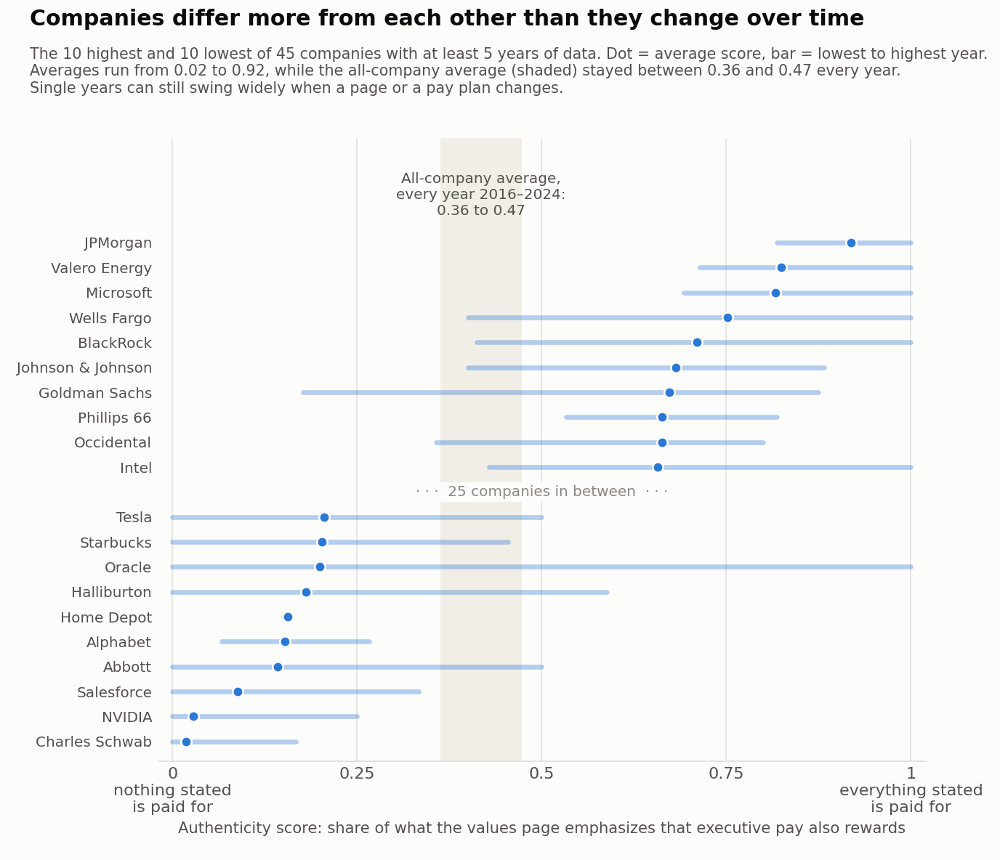

# Do companies pay for what they say they value?

*Part 3 summary: the Organizational Authenticity Index, 48 large S&P 500 companies, 2016 to 2024*

## What we measured
For each company and year, the **authenticity score** compares its website values page with its proxy statement's bonus criteria: **of everything the page emphasizes, how much are executives also paid to deliver?**
- **1** means every stressed value appears among the bonus criteria; **0** means none does.
- Values a page puts front and center count more than passing mentions.
- A stricter version counts a value as fully backed only when at least 10% of the bonus rides on it.

**48 of the 50 companies have a score.**
- **Apple** has no values page.
- **Berkshire Hathaway** ties no executive pay to performance criteria (Warren Buffett receives no bonus or stock awards; other bonuses are discretionary), itself a finding.

## What we found
1. **The typical company backs about two-fifths of what it says.**
   - The average score is **0.42**, and **0.34** on the stricter test.
   - Many non-financial goals are only unweighted "factors the committee considers".
2. **Companies differ more from each other than they change over time.** Rankings cover the 45 companies with at least five years of data.

   

   *The 10 highest- and 10 lowest-scoring companies (dot = average, bar = lowest to highest year). Company averages run from 0.02 to 0.92; the all-company average stayed between 0.36 and 0.47 every year.*

   - **Highest:** JPMorgan Chase (0.92), Valero (0.82) and Microsoft (0.82). Their executive scorecards name the stakeholders their pages do.
   - **Lowest:** Charles Schwab (0.02), NVIDIA (0.03) and Salesforce (0.09). Their pages stress customers, innovation and community (NVIDIA's, mainly innovation); Schwab's and NVIDIA's bonuses depended only on financial results every year.
3. **Energy companies and banks score highest; consumer and tech companies lowest.**
   - Energy averages 0.53, Financials 0.53, Consumer Discretionary 0.31 and Technology 0.33.
   - Energy pay plans routinely include safety (92% of company-years) and environmental targets (72%), and most bank plans (62%) risk and conduct: what these companies say they value.
4. **No overall trend, but not because nothing changed.**
   - Yearly averages stay between 0.36 and 0.47. Part of the 2024 high (0.47) is a correction: 2024 now also counts the following year's proxy, like every other year (0.40 without it).
   - **Pay did change.** Environmental bonus criteria rose from 6% to 55% of company-years, and diversity criteria from about a fifth to over half.
   - **But pages added the same themes,** so the ratio held. When a page states environmental values, pay rewarded them in 68% of cases by 2024, up from 20% in 2016.
   - **Three shifts offset that gain:** more page emphasis on community (almost never rewarded), less on shareholders (always rewarded), and a dip around 2021 in pay coverage of stated customer values.
5. **Some backing is token; Microsoft is the clearest case.**
   - Its scorecard names customers, employees, diversity, innovation and conduct, but in 2019 customers carried 16% of the bonus and the others only 4% to 8% each.
   - Microsoft ranks **3rd of 42** on the basic score, **11th** if a value needs 10% of the bonus to count fully, and **19th** at 20%. Thermo Fisher (15th to 34th) and SLB (18th to 32nd) follow the same pattern.
6. **About one in five non-financial areas covered by a bonus never appears on the values page**, most often diversity, then employee, conduct and safety goals: "doing without saying" (Part 4).

## What the score can see, and what it cannot
**It sees real changes in pay.** Once energy-transition goals entered ExxonMobil's bonus (one criterion in its 2021 proxy, four from 2022), the score turned its long-standing environmental statement from unbacked to backed.

**It cannot judge what the pay rewards.** Wells Fargo scores well (0.75), but its history shows the limit:
- **Before the 2016 fake-accounts scandal,** its one customer bonus goal was "deep and enduring relationships with our customers", the cross-selling target behind the misconduct, which the score counts as customer-backed.
- **In the scandal year,** the former CEO and retail-bank head lost their bonuses and unvested stock; pay was tied to financial results alone.
- **After the scandal,** risk and conduct grew to 44% of the bonus.

**The score shows when values and pay name the same stakeholder, not whether pay rewards serving that stakeholder or exploiting them.**

## How to use this
- **Investors and analysts:** a screening question, not a verdict. A low score asks whether any incentive reinforces the stated values; a big basic-vs-strict gap means commitments carry little money.
- **Boards:** the per-value breakdown lists stated values with no incentive behind them: candidates for the scorecard, or signs the page overstates.
- **Researchers:** rankings are stable across thresholds (rank correlations 0.86 to 0.98). With only company-disclosed weights the correlation is 0.79, or 0.95 without Intel and SLB. Compare within industries.

## What the score is not
- **Not a measure of honesty.** Paying only for financial results scores low by design (Schwab, NVIDIA and Home Depot every year), whatever a company does elsewhere. The score measures one visible, costly channel: executive incentives.
- **Top executives only, as disclosed.** Most firms state no weights for non-financial goals, so the strict version partly relies on estimates.
- **2024's large companies only.** Firms that left the index, perhaps those with the widest gaps, are missing.
- **AI-read, hand spot-checked.** Single company-years can be noisy; multi-year averages are more reliable.

## Bottom line
Large US companies back about 40% of what they say they value with executive pay, about a third once only meaningful bonus weight counts. The ratio held steady from 2016 to 2024 as environmental and diversity goals entered pay, because the pages broadened too. The useful signal is the detail: which stated values have money behind them, and which are on the scorecard in name only.
