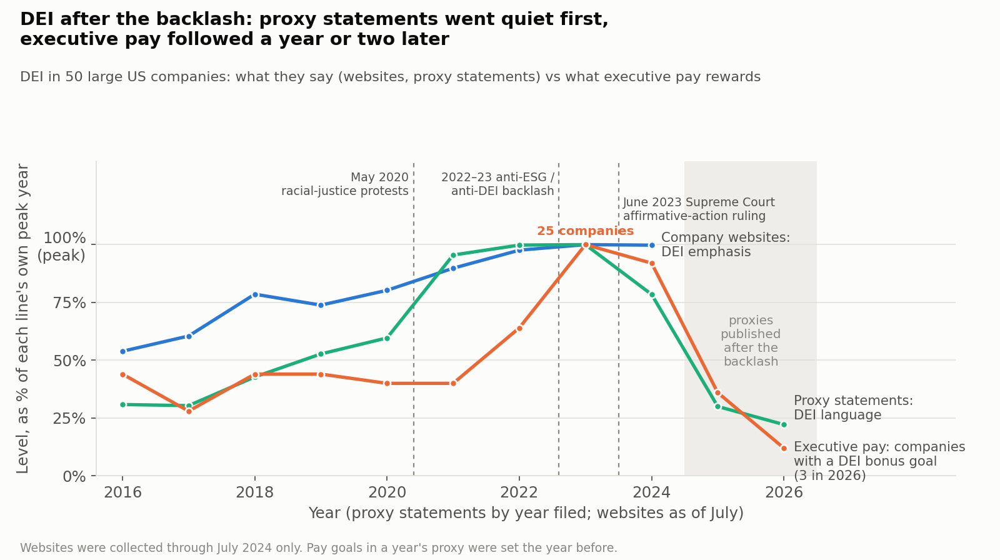

# After the backlash: did companies go quiet, or actually change course?

## In one paragraph
After the 2023 backlash against DEI, large US companies first went quiet
about DEI in their **proxy statements**, the annual documents explaining
governance and executive pay. They did **not** go quiet on their **websites**,
which still emphasized DEI as much as ever in mid-2024. Executive pay seemed
untouched at first, but that was a timing illusion: once pay plans designed
after the backlash became public (in 2025-2026), explicit DEI goals largely
disappeared from pay too. Most companies replaced them with broader "people"
or "culture" goals. Whether those new goals still measure the same things is
something the current disclosures cannot tell us.

*Proxy statements went quiet on DEI first. Executive pay followed a year or two later, falling from 25 companies with a DEI bonus goal to 3. Websites were still at their peak in mid-2024, the last year collected.*

## How we got there

**1. The hypothesis: "quiet retention".** A popular view holds that companies
stopped talking about DEI but quietly kept their commitments ("greenhushing").
We tested it on 50 large US companies by comparing what they **say** (websites
and proxy statements) with what they **pay executives for**.

**2. The first result seemed to confirm it.** In proxies published in 2023 and
2024, the number of companies tying executive pay to DEI jumped from 16 to 25,
even as DEI language in those same proxies stalled and then fell. Among the 17
companies with both DEI talk and DEI pay goals before the backlash, 5 cut only
the talk and none cut only the pay.

**3. Then we found a confound: the pay calendar.** A proxy published in spring
2024 describes pay plans designed in early 2023, before the June 2023
affirmative-action ruling. The 2023-2024 proxies were reporting decisions made
before the backlash.

**4. The out-of-sample test.** We collected the 2025 and 2026 proxies, the
first to report plans designed after the backlash, and applied exactly the
same method.

| Explicit DEI goals in executive pay | 2022 | 2023 | 2024 | 2025 | 2026 |
|---|---|---|---|---|---|
| Number of companies | 16 | 25 | 23 | 9 | 3 |

Of the 17 companies that had both before, 11 cut both DEI talk and explicit
DEI pay goals. Only AbbVie kept both.

**5. The revised conclusion.** Strong quiet retention, keeping the same DEI
goals while saying less, does not hold up. What the data show is an order of
retreat across channels:

| Channel | What happened |
|---|---|
| Proxy statements | Retreated first: DEI language fell from 2024 and is now about a quarter of its 2022 level |
| Company websites | Had not retreated by July 2024: 40% of About/values pages still emphasized DEI, the same as in 2022 (22% in 2016) |
| Executive pay | Followed one to two years later, as explicit DEI goals were taken out |

## The open question: renamed, or removed?
Of the 23 companies paying for DEI in 2024:
- **13 replaced the DEI goal with a generic people, culture or talent goal.**
  Examples:
  - American Express dropped "diversity representation" but kept "talent
    retention" and "culture".
  - Halliburton replaced four diversity targets with "workforce
    localization".
  - Alphabet's bonus described its social goal as "progress toward our DEI
    goals" in 2023 and as building "products for a global audience" in 2024.
- **5 dropped DEI with nothing in its place:** Apple, ConocoPhillips,
  Salesforce, Medtronic, Pfizer.
- **5 kept an explicit DEI goal:** AbbVie, Microsoft, Starbucks, SLB, Thermo
  Fisher.

For the 13, the **label retreated, but the substance is unknown**. The new
goals might be a genuine removal of the DEI objective, or the same targets
under a safer name, which would itself be a form of quiet retention. Today's
disclosures cannot tell the two apart. The question would be settled by the
**metrics behind the new goals**, if later proxies disclose them: for example,
whether a "talent" goal still includes representation or promotion targets by
group, or a "culture" score still includes an inclusion index.

## Environment is different
Talk about environmental goals also fell after 2023, but pay-linked
environmental goals declined only modestly (from 26 to 15 company-years).
Energy companies such as ExxonMobil, Valero and SLB kept paying for
environmental performance while saying less about it. That is the closest
thing to genuine quiet retention in this study.

## How far to trust it
- **Small sample:** 50 companies, and fewer than 20 had both talk and pay on
  each theme before 2023. The firm counts are illustrations, not statistics.
- **Short window:** only two years of post-backlash pay plans exist so far;
  2026 is missing Microsoft and Tesla, which had not yet filed.
- **Websites are observed once a year,** on one page per company, and only up
  to July 2024. A website retreat after that date would not be seen.
- **Classifying goals involves judgment.** Each case is listed so readers can
  check it.

## What a reader could do with this
- **Investors and stewardship teams:** ask companies that renamed DEI goals
  what the new goals measure, and how much pay depends on them. That single
  question separates removal from relabeling.
- **Boards:** if a commitment survives under a new name, disclose its metric.
  Otherwise investors will reasonably assume it was dropped.
- **Researchers and journalists:** judge policy changes by the right channel
  and the right year. Websites, proxy language and pay move at different
  speeds, and proxies lag decisions by a year.
